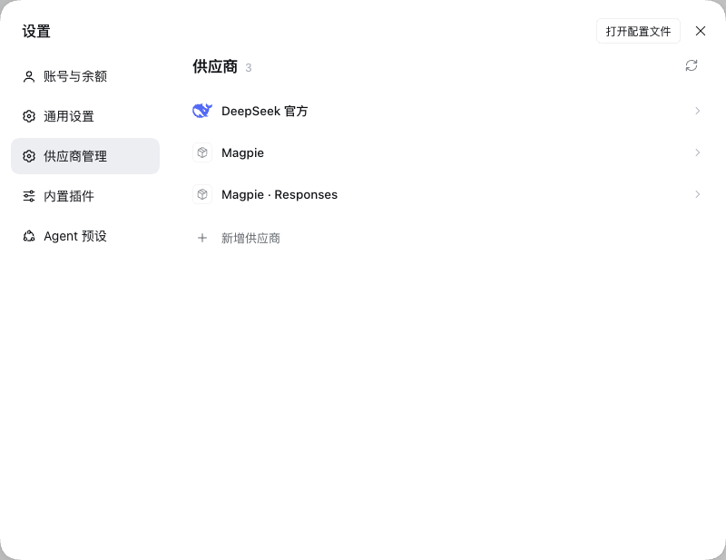
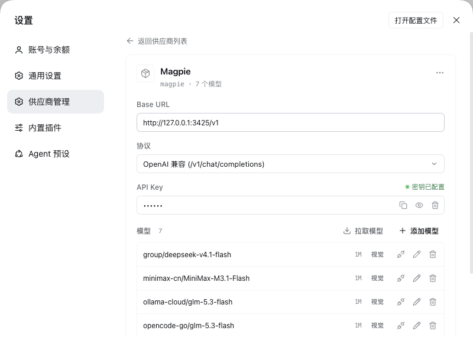
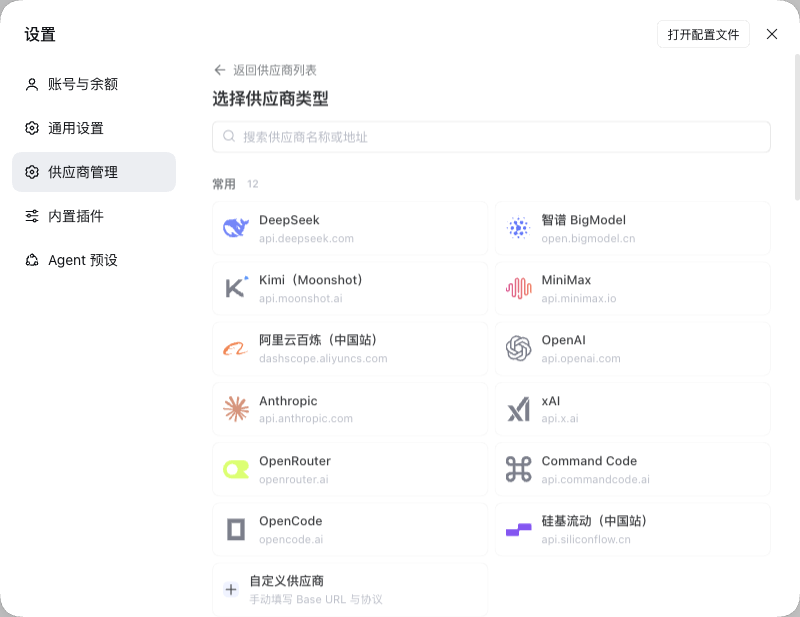
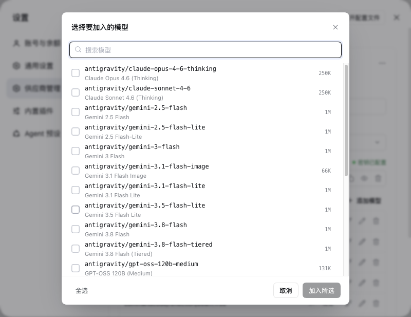
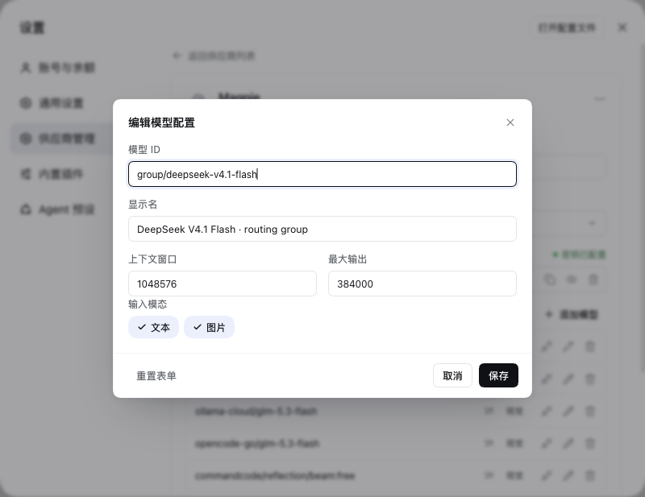
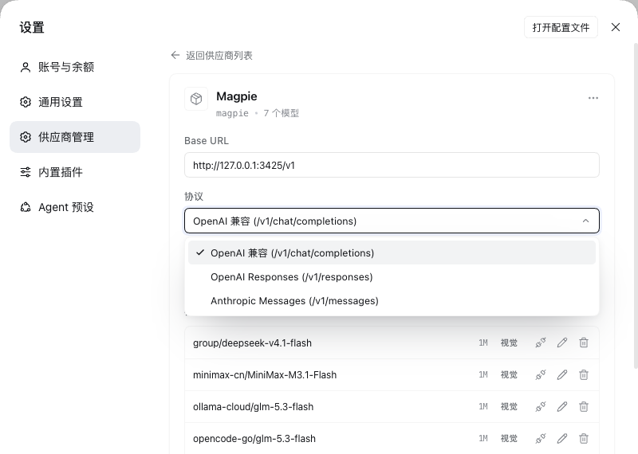

# dsh-provider-studio · 供应商管理

**English** — A third-party settings page for DeepSeek Harness. It replaces the built-in **Models** panel and edits the `llm-pi-ai` provider configuration directly: browse providers, reveal / replace / clear API keys, and manage models without hand-editing `cordis.patch.yml`.

DSH（DeepSeek Harness）自带的 Models 设置页只认 schema 投影后的字段，保存时会丢掉模型上未声明的配置，API 密钥也只写不回显。这个插件在设置面板里另开一页「供应商管理」，直接读写 `llm-pi-ai.providers` 和 DSH 凭据服务：一级是供应商列表，二级是所选供应商的编辑页；密钥可显示、复制、更换、清除，模型可增删改并做真实连通性测试。

## 预览

**供应商列表**：一行一个供应商，点进去是二级编辑页。



**供应商详情**：Base URL、协议、API 密钥和模型表都在一页里；标题旁的 `…` 菜单放重命名和删除。



**新增供应商**：先选模板（223 个，带品牌 logo），也可以从空白自定义开始。



**拉取模型**：用当前端点列出可用模型，支持搜索与批量勾选。



**编辑模型**：模型 ID、显示名、上下文窗口、最大输出、输入模态。



**协议选择**：自定义下拉，不再调起系统菜单。



保存结果以右下角提示呈现：


## 功能

### 供应商列表

- 每行一个供应商：品牌图标 + 显示名，点一行进入详情；标题右侧刷新，列表末尾是「+ 新增供应商」。
- 列表同时包含 `llm-pi-ai` 的第三方供应商与内置的 **DeepSeek 官方**（来自内置条目 `llm-deepseek`）。两者在这里都是普通行，区别只有：内置行不可删除，协议只读。
- 设置服务只读时，页面会提示并禁用保存。

### 供应商详情

- 可编辑显示名称（点标题就地改名）、协议、Base URL 和模型表；路由 ID（`route`）创建后不可改。标题右侧 `…` 菜单提供「重命名」和「删除供应商」。
- 协议三选一：OpenAI 兼容（`/chat/completions`）、OpenAI Responses（`/responses`）、Anthropic Messages（`/messages`）；内置 DeepSeek 行显示为独立的官方协议。
- 支持 `Cmd/Ctrl+S` 保存；有未保存修改时底部提示、保存按钮才可用，直接返回列表会先确认是否放弃修改。保存结果以右下角提示呈现，写入未真正落盘时会单独报错（见「实现要点」）。

### API 密钥

- 默认掩码，可**显示 / 隐藏 / 复制 / 更换 / 清除**。更换在同一行内完成（回车保存、Esc 取消），清除前有确认弹窗。
- 密钥的权威副本始终在 DSH 凭据服务里；本插件自身不把密钥写进 `llm-pi-ai` 配置，也不落盘。
- 显示 / 复制依赖 DSH 凭据服务能读到真实值；读不到时只显示空值，不会伪造明文。
- 凭据名（环境变量名）不需要手填：创建时如果填了密钥，按 route 派生（如 `deepseek` → `DEEPSEEK_API_KEY`）；编辑已有供应商不会改写它。

### 模型

- 模型表一行一个模型：模型 ID、上下文窗口徽章、视觉能力徽章，以及测试 / 编辑 / 删除三个动作。
- 编辑走弹窗：模型 ID、显示名、上下文窗口、最大输出、输入模态（文本 / 图片），支持重置表单。
- **测试是真实请求**：Host 按该供应商协议向端点发一个最小请求（聊天类 `max_tokens: 1`，Responses 类 `max_output_tokens: 16`），20 秒超时，返回 `✓ 延迟` 或具体的 HTTP 错误。
- 页面内部的 `input` 与 DSH 的 `inputModalities` 在边界互相转换；不在表格里的字段（`reasoningEfforts`、`compat`、`thinking` 等）保存时原样保留。

### 从端点拉取模型

- 用当前 Base URL + 密钥请求 `GET {baseURL}/models`，弹窗列出端点返回的模型，可搜索、全选 / 清空，勾选后批量并入模型表。
- 同时兼容 OpenAI 风格（`data[]`）、Anthropic 风格（`data[]` / `models[]`）以及裸数组三种返回。

### 模板与 logo

- 「新增供应商」先进入模板选择器，模板来自 [models.dev](https://github.com/sst/models-dev) 的全量供应商目录（名称、API root、环境变量名、协议映射），共 **223 个**。
- 其中 45 个精选条目带中文名并分组（常用 / 国内厂商 / 海外厂商 / 网关），其余 178 个在「更多供应商」组；每组默认显示 12 个、可展开，顶部搜索框可检索全部条目。
- 模板只预填 Base URL / 协议 / 首个模型 ID。模型 ID 只是建议值，DSH 的模型目录与其他客户端不同，创建前请按账户实际可用的模型确认。
- 品牌 logo：图标目录里 152 个 logo 文件，覆盖 223 个模板中的 173 个（来源见「数据来源与致谢」）；没有 logo 的显示中性占位图标。
- 需要专用 SDK 的厂商（Google、Bedrock、Azure 等）不收录，因为 DSH 的 `llm-pi-ai` 只支持上面三种协议。
- 「常用」分组里还带一个「自定义供应商」入口，用于任意 OpenAI 兼容端点。

### 与官方 Models 设置页的关系

`cordis.patch.yml` 除了插入本插件，还带一行：

```yaml
- id: ui-settings-models
  disabled: true
```

效果是设置面板里不再出现官方「Models」页，只剩本插件的「供应商管理」。这是 patch 层覆盖，不是删除包：

- 想同时保留官方页：把 `disabled: true` 改成 `false`（或删掉这两行），重启 DSH；
- 卸载本插件同样会恢复官方页；
- 只禁用这一个 package。`llm-pi-ai` / `llm-deepseek`（模型适配器）、`ui-model-selection`（composer 里的模型选择器）、`credentials` 相关（密钥服务）**不要**禁用。

代价：官方 Models 页里的「DeepSeek 账号登录」入口、以及官方对内置 `llm-deepseek` 供应商的编辑入口会一并消失；内置 DeepSeek 的密钥 / Base URL / 模型表改由本插件编辑。

## 安装

前置：DSH 桌面版（本插件按 `0.2.1-rc.5` 实测）；`dsh` CLI 已在 PATH 中。仓库里已带有构建好的 `client.js`，**安装不需要先构建**。

```bash
git clone https://github.com/realchendahuang/dsh-provider-studio.git ~/code/dsh-provider-studio
dsh plugin --profile <profile> add /path/to/dsh-provider-studio
```

- `<profile>` 换成你的 DSH profile（如 `desktop`、`web`）。安装本地目录会以 pnpm `link:` 依赖写入该 profile，不复制文件；之后更新仓库内容不需要重新 `add`。
- 建议把仓库放在固定路径，例如 `~/code/dsh-provider-studio`，然后：

```bash
dsh plugin --profile desktop add ~/code/dsh-provider-studio
```

### 重启 DSH 后生效

安装或更新后需要**完整退出并重新启动 DSH**，而不是只刷新窗口：

- Host 端代码（`index.js`）只在 DSH 启动时加载，刷新页面 / 重开设置不会加载新的 Host 代码；
- 刷新窗口只会重载 `client.js`（浏览器端）。
- 首次安装后如果「测试」提示需要重启 DSH（或报 404 / transport failure），说明 Host 端还是旧的，重启 DSH 即可；界面里也会显示这条提示。

重启后打开 设置 →「供应商管理」（英文界面为 Providers）。

### 更新

本地 link 安装下，改完源码后：

```bash
cd ~/code/dsh-provider-studio
npm install            # 只有改了依赖或首次开发时才需要
npm run build:client   # 只有改了 src/client/ 时才需要；生成的 client.js 要保留
```

然后重启 DSH。Host 端 `index.js` / `contract.js` 是手写 ESM，无需构建。

### 卸载

```bash
dsh plugin --profile <profile> remove dsh-provider-studio
```

重启 DSH 后官方 Models 页恢复。

## 实现要点

- **读取时直接解析 profile patch 文档原文**，而不是 `settings.describe()` 的 schema 投影：投影会丢掉 schema 未声明的字段（每个模型的 `reasoningEfforts` 档位、`compat` 等），保存时就会悄悄丢失。
- 写入优先走 `settings.replace()`（没有 replace 时退回 update），写完再读回文档**校验是否真的落盘**；界面会显示「保存未落盘」而不是假装成功。
- 密钥不落本插件：权威副本始终在 DSH 凭据服务，插件只通过 `credentials` 服务读写。
- Host ↔ Client 走 Typert Remote（`providerPanel` 服务），不注册全局 HTTP 路由。
- 没有遥测；除用户主动触发的「测试」「拉取模型」会请求所配置的供应商端点外，插件不发起外部网络请求。

## 数据来源与致谢

- [models.dev](https://github.com/sst/models-dev)（MIT）：供应商目录数据（名称、API root、环境变量名、协议映射）。
- [lobe-icons](https://github.com/lobehub/lobe-icons)（MIT）：品牌 logo；lobe-icons 未收录的由 `scripts/fetch-favicons.py` 从其官网或文档站抓取 favicon。
- [Lucide](https://lucide.dev)（ISC）：界面图标（由 `scripts/gen-ui-icons.mjs` 烘焙进 `src/client/ui-icons.jsx`）。
- [ZCode](https://github.com/zai-org/zcode)（Apache-2.0）：设置页的交互与信息结构参考；本插件未复制其源代码或素材。页面里出现的品牌名称与 logo，商标和版权归各厂商所有。

## 开发

```
index.js            Host 端：settings / credentials 读写、测试与拉取模型
contract.js         Host ↔ Client 契约：服务名、RPC 描述
src/client/         浏览器端（JSX 源码）
client.js           浏览器端构建产物，随仓库提交（安装时直接加载）
cordis.patch.yml    bundle patch：插入本插件 + 隐藏官方 Models 页
icons/              品牌 logo 原始文件
locale/             设置分区标题/描述的本地化
scripts/            构建与资源生成脚本
```

```bash
npm install
npm run build:client          # src/client/ → dist/client.bundle.cjs → client.js
node scripts/gen-icons.mjs    # icons/ → src/client/icons.js
node scripts/gen-ui-icons.mjs # Lucide 字形 → src/client/ui-icons.jsx
python3 scripts/fetch-favicons.py  # 为缺 logo 的模板抓官网 favicon（需 Pillow）
```

- `client.js` 由 `scripts/build-client.mjs` 用 esbuild 打成 CJS，再包进 `window.__ModuleLoader__.load` 的 factory；React 由 DSH 的模块表提供，不打进 bundle。
- `src/client/icons.js`、`src/client/ui-icons.jsx`、`dist/` 都是生成物，不要手改；`client.js` 是例外——它是需要提交的发布产物。
- `scripts/fetch-favicons.py` 读取本机的 `/tmp/providers.json` 与 `/tmp/models-dev.json` 缓存并写入 `icons/`，不是安装或构建的必需步骤。

## 已知限制

- Host 端改动必须重启 DSH 才生效（见「安装」）。
- 只管理 `llm-pi-ai` 的供应商（外加内置 `llm-deepseek`）；不支持需要专用 SDK 的协议。
- 新建供应商至少要有一个模型条目。删除供应商、清除密钥、放弃未保存修改都会先弹出二次确认。
- 模型表只编辑常用字段，`reasoningEfforts` / `compat` 等高级字段不在表格里，但保存时原样保留。
- 模板与模型 ID 只是预填建议，不代表账户一定有权限调用。
- 按 DSH `0.2.1-rc.5` 实测；插件依赖 DSH 内部的 settings / credentials / Typert Remote 形态，DSH 升级后可能需要适配。

## License

[MIT](LICENSE) © 2026 dsh-provider-studio contributors
