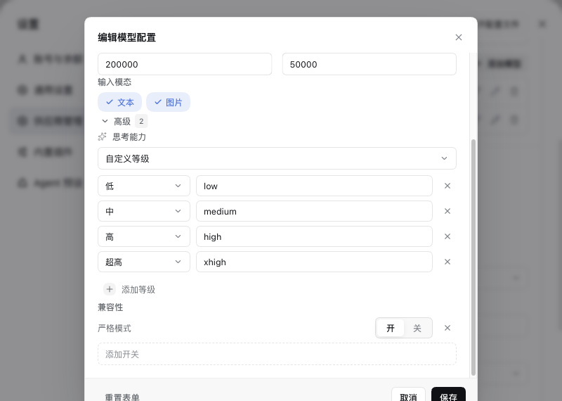
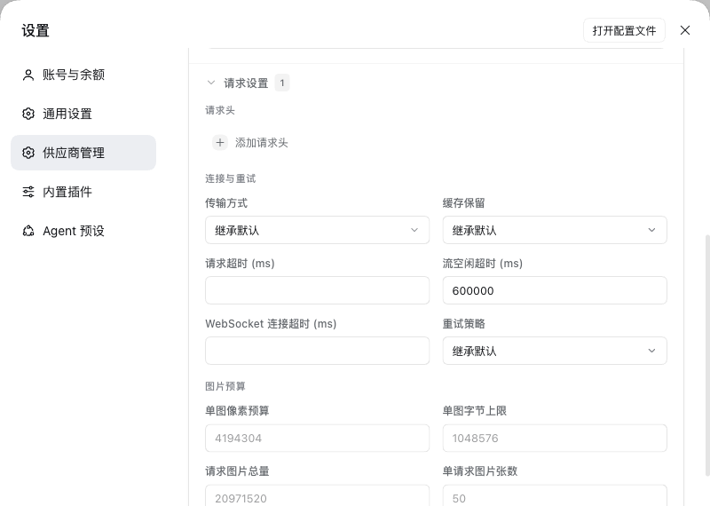
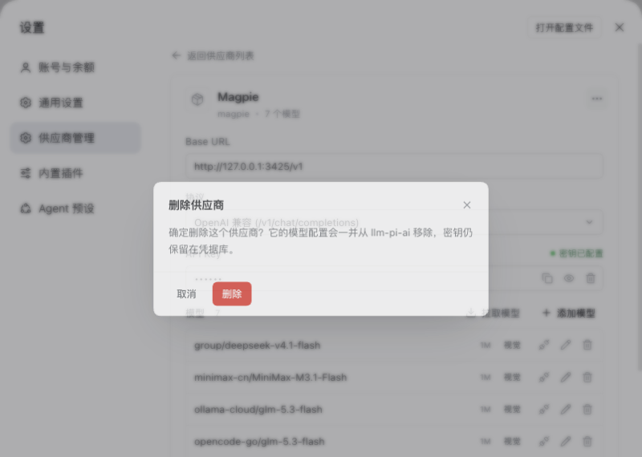

# dsh-provider-studio · 供应商管理

[](#安装)
[](https://github.com/realchendahuang/dsh-provider-studio/releases)
[](LICENSE)
[](https://github.com/realchendahuang/dsh-provider-studio/commits/main)
[](https://github.com/realchendahuang/dsh-provider-studio/graphs/commit-activity)
[](https://github.com/realchendahuang/dsh-provider-studio/issues)
[](#贡献)

**English** — A third-party settings page for DeepSeek Harness. It replaces the built-in **Models** panel and edits the `llm-pi-ai` provider configuration directly: browse providers, reveal / replace / clear API keys, and manage models without hand-editing `cordis.patch.yml`.

DSH（DeepSeek Harness）自带的 Models 设置页只认 schema 投影后的字段，保存时会丢掉模型上未声明的配置，API 密钥也只写不回显。这个插件在设置面板里另开一页「供应商管理」，直接读写 `llm-pi-ai.providers` 和 DSH 凭据服务：一级是供应商列表，二级是所选供应商的编辑页；密钥可显示、复制、更换、清除，模型可增删改并做真实连通性测试。参数按归属分开：模型自己的思考等级与兼容开关在模型弹窗里，供应商自己的请求头、传输与重试、图片预算在供应商页里，都直接落到配置文件。

## 特点

- **密钥真的能看见**：官方页只写不回显；这里默认掩码，点一下就能显示、复制、更换、清除。
- **参数不止能保住，还能改**：直接解析 profile 里的原始配置而不是 schema 投影；模型自己的 `reasoningEfforts`（思考等级）与 `compat`（兼容开关）放在模型弹窗里，供应商自己的请求头 / 传输与重试 / 图片预算放在供应商页里，各归各位。
- **一个页面管完**：供应商、Base URL、协议、密钥、模型增删改、单模型连通性测试、从端点批量拉取模型，不用再手改 `cordis.patch.yml`。
- **新增供应商不用查文档**：内置 models.dev 全量目录里的 223 个模板（常用 / 国内 / 海外 / 网关），带品牌 logo；选一下就把 Base URL、协议、环境变量名填好。
- **交互不将就**：就地改名、`…` 菜单、二次确认、未保存拦截、`Cmd/Ctrl+S`、右下角 Toast；Lucide 图标 + 统一动效，深色/浅色都可用。
- **随时能退回官方页**：官方 Models 页由 bundle patch 隐藏，改一行配置就能恢复，不删包、不影响 `llm-pi-ai` / `llm-deepseek` 适配器。

## 预览

|  |  |
|:---:|:---:|
| <br>供应商列表：只显示名字，点进二级页 | <br>供应商详情：URL、协议、密钥、模型一页管完 |
| <br>模板选择器：223 个模板带品牌 logo | <br>拉取模型：搜索、全选、批量加入 |
| <br>编辑模型：基础字段 + 模型自己的高级（思考等级） | <br>模型高级里的兼容开关：按协议列出可覆盖字段 |
| <br>请求设置：请求头、传输与重试、图片预算 | <br>协议选择：自绘下拉，不调系统菜单 |

保存结果以右下角提示呈现，不打断当前页面：

|  |
|:---:|
| <br>保存提示：右下角 Toast，成功/失败都有 |

## 快速开始

```bash
# 1. 装到桌面版 profile
dsh plugin --profile desktop add github:realchendahuang/dsh-provider-studio

# 2. 完全退出 DSH 再重新打开（不是刷新窗口）

# 3. 设置 →「供应商管理」（英文界面为 Providers）
```

装好后官方「Models」页会被替换成「供应商管理」，现有供应商和模型原样出现在列表里。

## 安装

前置：DSH 桌面版（本插件按 `0.2.1-rc.5` 与 `0.2.2-rc.1` 实测）；`dsh` CLI 已在 PATH 中。仓库里已带有构建好的 `client.js`，**安装不需要先构建**。

DSH 按 **profile** 隔离插件：桌面版用 `desktop`，`dsh web` 用 `web`，所以命令里的 `--profile` 要和你实际启动的那个一致。

### 方式一：直接从 GitHub 安装（推荐）

```bash
dsh plugin --profile desktop add github:realchendahuang/dsh-provider-studio
```

- `<profile>` 换成你的 DSH profile（`desktop`、`web` 等）。
- 也可以写成完整地址：`git+https://github.com/realchendahuang/dsh-provider-studio.git`。
- 想固定版本就带 commit：`github:realchendahuang/dsh-provider-studio#<commit-sha>`。
- pnpm 会把仓库拉进 profile 的 `node_modules`，并按 `package.json` 安装运行依赖（`yaml`、`@deepseek-ai/dsh-typert-protocol`）。插件没有 `prepare` / 安装时构建脚本，安装过程不会编译任何东西。

### 方式二：克隆到本地（开发 / 改代码）

```bash
git clone https://github.com/realchendahuang/dsh-provider-studio.git ~/code/dsh-provider-studio
dsh plugin --profile desktop add ~/code/dsh-provider-studio
```

本地目录以 pnpm `link:` 依赖写入 profile，不复制文件；之后 `git pull`、改源码都不用重新 `add`。

### 确认装上了

```bash
dsh plugin --profile desktop why dsh-provider-studio
```

能列出这个包就说明依赖和 bundle 都注册了。重启 DSH 后，设置里应出现「供应商管理」，官方「Models」页消失。

### 重启 DSH 后生效

安装或更新后需要**完整退出并重新启动 DSH**，而不是只刷新窗口：

- Host 端代码（`index.js`）只在 DSH 启动时加载，刷新页面 / 重开设置不会加载新的 Host 代码；
- 刷新窗口只会重载 `client.js`（浏览器端）；
- 首次安装后如果「测试」提示需要重启 DSH（或报 404 / transport failure），说明 Host 端还是旧的，重启 DSH 即可。

### 更新

- **GitHub 安装**：先 remove 再 add（或直接带新 commit 重新 add）：

```bash
dsh plugin --profile desktop remove dsh-provider-studio
dsh plugin --profile desktop add github:realchendahuang/dsh-provider-studio
```

- **本地 link 安装**：`git pull` 后按需构建：

```bash
cd ~/code/dsh-provider-studio
npm install            # 只有改了依赖或首次开发时才需要
npm run build:client   # 只有改了 src/client/ 时才需要；生成的 client.js 要保留
```

改完重启 DSH。Host 端 `index.js` / `contract.js` 是手写 ESM，无需构建。

### 卸载

```bash
dsh plugin --profile <profile> remove dsh-provider-studio
```

重启 DSH 后官方 Models 页恢复。

## 使用

### 打开

设置 →「供应商管理」。页面里列出当前 profile 的所有 `llm-pi-ai` 供应商，外加内置的 **DeepSeek 官方**（来自 `llm-deepseek`，可编辑、不可删除）。

### 新增供应商

1. 列表底部点「+ 新增供应商」。
2. 选一个模板（按分组浏览或直接搜索名称/域名），或选「自定义供应商」从空白开始。
3. 填写表单：
   - **显示名称**：列表里显示的名字，留空则用路由 ID。
   - **路由 ID**：配置里的唯一键，只能包含字母、数字、`.`、`_`、`-`，创建后不建议改。
   - **协议**：OpenAI 兼容（`/chat/completions`）、OpenAI Responses（`/responses`）、Anthropic Messages（`/messages`）。
   - **Base URL**：例如 `https://api.example.com/v1`。
   - **API Key**：可以留空，稍后在详情页补。
   - **首个模型 ID**：至少填一个，创建后再增删。
4. 点「创建」，成功后自动进入该供应商的详情页。

### 填写 / 更换密钥

- 点 API Key 输入框即可编辑：已配置的密钥会先显示为掩码，聚焦后变成真实值，改完回车保存。
- 输入框右侧三个动作：复制、显示/隐藏、清除（有值时）；清除会先弹确认。
- 密钥只写进 DSH 凭据服务，不写进 `llm-pi-ai` 配置，也不落本插件的文件。

### 拉取模型

点模型区右上角的「拉取模型」，插件会用当前 Base URL + 密钥请求 `GET {baseURL}/models`，弹窗里搜索、全选或逐个勾选，点「加入所选」并入模型表——注意这时还只是草稿，点「保存」才写盘。

### 测试连通性

每个模型行右侧的「测试」按钮会发一个**真实**最小请求：

- 聊天类协议发 `max_tokens: 1`，Responses 类发 `max_output_tokens: 16`，Anthropic 类同理，20 秒超时；
- 成功显示 `✓ 延迟`，失败显示红色失败徽章，鼠标悬停看具体 HTTP 错误；
- 结果约 6 秒后自动消失。

### 编辑 / 删除模型

点模型 ID 或铅笔图标打开弹窗：模型 ID、显示名、上下文窗口、最大输出、输入模态（文本 / 图片），可以重置表单。删除模型只改草稿，保存后才生效。

### 模型的高级参数

模型弹窗里，「输入模态」下面是**模型的**「高级」，默认收起（模型已经声明过思考等级或兼容开关时自动展开），标题旁的数字表示当前覆盖了几项。里面只有模型自己的东西：

- **思考能力**（`reasoningEfforts`）三选一：
  - **继承内置目录**（默认）：不在配置里声明，交给 pi-ai 的模型目录决定；
  - **不支持思考**：写入 `reasoningEfforts: false`，明确声明这是非推理模型；
  - **自定义等级**：一条一条声明「等级 → 实际发送值」，例如 `低 / low`、`最高 / max`；`关` 的发送值可以留空。
  「添加等级」会按升级顺序补下一个档位（已有 low/medium/high 时补 `max`）。至少要保留一个 `off` 以外的等级，否则保存会被拦下并提示。
- **兼容开关**（`compat`）：可选字段随协议变化——OpenAI 兼容 19 项（`thinkingFormat`、`maxTokensField`、`chat_template_kwargs` 等）、Responses 4 项、Anthropic 7 项；每项是开关或枚举下拉，不设置就交给 pi-ai 自动判断。

### 供应商的请求设置

供应商详情页模型表下面是**供应商自己的**「请求设置」，和模型参数完全分开；默认收起，标题上的数字表示当前覆盖了多少项：

- **请求头**：自定义 HTTP 头，网关做鉴权 / 路由时常用；
- **连接与重试**：传输方式（auto / sse / websocket…）、缓存保留、请求超时、流空闲超时、WebSocket 连接超时、重试策略与次数；
- **图片预算**：单图像素预算、单图字节上限、请求图片总量、单请求图片张数、离屏回收粒度。

内置 **DeepSeek 官方**行是 llm-deepseek 自己的词汇，也有一个只属于它的高级区：思考模式、推理等级、输出上限、流空闲超时、重试策略。

### 重命名 / 删除供应商

- 点标题就地改名，回车确认，Esc 取消。
- 标题右侧 `…` →「重命名」/「删除供应商」；删除前会弹确认：

|  |
|:---:|
| <br>删除供应商前的二次确认（清除密钥、放弃修改同理） |

### 保存规则

- 底部「保存」在有改动时才可点，左侧会提示「有未保存的更改」；`Cmd/Ctrl+S` 等效。
- 「重新加载」丢弃草稿、重新读一次磁盘配置。
- 有未保存改动时返回列表，会先确认是否放弃。
- 保存成功/失败都以右下角 Toast 提示；写入未真正落盘会单独报错，不会假装成功。

## 功能细节

### 供应商列表

- 每行一个供应商：品牌图标 + 显示名，点一行进入详情；标题右侧刷新，列表末尾是「+ 新增供应商」。
- 列表同时包含 `llm-pi-ai` 的第三方供应商与内置的 **DeepSeek 官方**（来自内置条目 `llm-deepseek`）。两者在这里都是普通行，区别只有：内置行不可删除，协议只读。
- 设置服务只读时，页面会提示并禁用保存。

### 供应商详情

- 可编辑显示名称（点标题就地改名）、协议、Base URL 和模型表；路由 ID（`route`）创建后不可改。标题右侧 `…` 菜单提供「重命名」和「删除供应商」。
- 协议三选一：OpenAI 兼容（`/chat/completions`）、OpenAI Responses（`/responses`）、Anthropic Messages（`/messages`）；内置 DeepSeek 行显示为独立的官方协议。
- 支持 `Cmd/Ctrl+S` 保存；有未保存修改时底部提示、保存按钮才可用，直接返回列表会先确认是否放弃修改。保存结果以右下角提示呈现，写入未真正落盘时会单独报错（见「实现要点」）。

### API 密钥

- 默认掩码，可**显示 / 隐藏 / 复制 / 更换 / 清除**。更换在同一行内完成（回车保存、Esc 取消），清除前有确认弹窗。
- 密钥的权威副本始终在 DSH 凭据服务里；本插件自身不把密钥写进 `llm-pi-ai` 配置，也不落盘。
- 显示 / 复制依赖 DSH 凭据服务能读到真实值；读不到时只显示空值，不会伪造明文。
- 凭据名（环境变量名）不需要手填：创建时如果填了密钥，按 route 派生（如 `deepseek` → `DEEPSEEK_API_KEY`）；编辑已有供应商不会改写它。

### 模型

- 模型表一行一个模型：模型 ID、上下文窗口徽章、视觉能力徽章，以及测试 / 编辑 / 删除三个动作。
- 编辑走弹窗：基础字段（模型 ID、显示名、上下文窗口、最大输出、输入模态）+ 模型自己的「高级」（思考等级、兼容开关），支持重置表单。
- pi-ai 的模型字段全都在界面上：`name`、`contextWindow`、`maxTokens`、`input`、`reasoningEfforts`、`compat`。
- **测试是真实请求**：Host 按该供应商协议向端点发一个最小请求（聊天类 `max_tokens: 1`，Responses 类 `max_output_tokens: 16`），20 秒超时，返回 `✓ 延迟` 或具体的 HTTP 错误。
- 页面内部的 `input` 与 DSH 的 `inputModalities` 在边界互相转换；内置 DeepSeek 的模型条目使用它自己的词汇（`inputModalities`），不套用 pi-ai 字段。

### 参数的分层

界面按「谁的东西放谁那儿」切开，两边互不串：

| 位置 | 只管 | 字段 |
|---|---|---|
| 模型弹窗 →「高级」 | 模型自己 | `reasoningEfforts`、`compat` |
| 供应商详情 →「请求设置」 | 供应商自己的连接与请求 | `headers`、`transport`、`cacheRetention`、`timeoutMs`、`streamIdleTimeoutMs`、`websocketConnectTimeoutMs`、`retryPolicy`、`requestImagePixelBudget`、`requestImageMaxBytes`、`maxRequestImageBytes`、`maxRequestImages`、`imageOffloadCountQuantum` |

- 未设置的项一律留空（= 沿用 pi-ai 默认），设置过的项在折叠时计入标题旁的数字。
- 模型级 `compat` 按当前协议过滤可选项，换了协议不会把旧协议的开关偷偷写回去；保存时 Host 再按 pi-ai 的规则校验一遍。
- 所有数值字段按 pi-ai 的约束校验（正整数、枚举取值、`retryPolicy.mode` 必填），不合法的值在保存时直接报错。
- 路由级的模型缺省值（`defaultContextWindow`、`defaultMaxTokens`、`defaultInput`、`reasoning`、`thinkingBudgets`）和 `modelOverrides` 没有进界面：它们只在「模型自己什么都没声明」时兜底，正常配置走模型自己的字段即可；确实需要时手写 `cordis.patch.yml`。

### 从端点拉取模型

- 用当前 Base URL + 密钥请求 `GET {baseURL}/models`，弹窗列出端点返回的模型，可搜索、全选 / 清空，勾选后批量并入模型表。
- 同时兼容 OpenAI 风格（`data[]`）、Anthropic 风格（`data[]` / `models[]`）以及裸数组三种返回。

### 模板与 logo

- 「新增供应商」先进入模板选择器，模板来自 [models.dev](https://github.com/sst/models-dev) 的全量供应商目录（名称、API root、环境变量名、协议映射），共 **223 个**。
- 其中 45 个精选条目带中文名并分组（常用 / 国内厂商 / 海外厂商 / 网关），其余 178 个在「更多供应商」组；每组默认显示 12 个、可展开，顶部搜索框可检索全部条目。
- 模板只预填 Base URL / 协议 / 首个模型 ID。模型 ID 只是建议值，DSH 的模型目录与其他客户端不同，创建前请按账户实际可用的模型确认。
- 品牌 logo：图标目录里 152 个 logo 文件，覆盖 223 个模板中的 173 个（来源见「数据来源与致谢」）；没有 logo 的显示中性占位图标。
- 需要专用 SDK 的厂商（Google、Bedrock、Azure 等）不收录，因为 DSH 的 `llm-pi-ai` 只支持上面三种协议。
- 「常用」分组里还带一个「自定义供应商」入口，用于任意 OpenAI 兼容端点。

## 与官方 Models 设置页的关系

`cordis.patch.yml` 除了插入本插件，还带一行：

```yaml
- id: ui-settings-models
  disabled: true
```

效果是设置面板里不再出现官方「Models」页，只剩本插件的「供应商管理」。这是 patch 层覆盖，不是删除包：

- 想同时保留官方页：把 `disabled: true` 改成 `false`（或删掉这两行），重启 DSH；
- 卸载本插件同样会恢复官方页；
- 只禁用这一个 package。`llm-pi-ai` / `llm-deepseek`（模型适配器）、`ui-model-selection`（composer 里的模型选择器）、`credentials` 相关（密钥服务）**不要**禁用。

代价：官方 Models 页里的「DeepSeek 账号登录」入口、以及官方对内置 `llm-deepseek` 供应商的编辑入口会一并消失；内置 DeepSeek 的密钥 / Base URL / 模型表改由本插件编辑。

## 实现要点

- **读取时直接解析 profile patch 文档原文**，而不是 `settings.describe()` 的 schema 投影：投影会丢掉 schema 未声明的字段（每个模型的 `reasoningEfforts` 档位、`compat` 等），保存时就会悄悄丢失。
- 写入优先走 `settings.replace()`（没有 replace 时退回 update），写完再读回文档**校验是否真的落盘**；界面会显示「保存未落盘」而不是假装成功。
- 密钥不落本插件：权威副本始终在 DSH 凭据服务，插件只通过 `credentials` 服务读写。
- 高级参数走 `saveProvider` 的 `patch.advanced`：Host 端按 pi-ai 的 schema 逐字段校验后再写（思考等级枚举、协议允许的 `compat` 字段、正整数范围），宁可报错也不写坏配置；客户端与 Host 各存一份同一套常量，靠 README 的字段表对齐。
- Host ↔ Client 走 Typert Remote（`providerPanel` 服务），不注册全局 HTTP 路由。
- 没有遥测；除用户主动触发的「测试」「拉取模型」会请求所配置的供应商端点外，插件不发起外部网络请求。

## 常见问题

**设置里没有「供应商管理」**

1. 确认装到了你正在用的 profile：`dsh plugin --profile desktop why dsh-provider-studio`；
2. 完全退出 DSH 再打开（刷新窗口不够）；
3. 检查 profile 的 `cordis.patch.yml` 里有没有 `- id: dsh-provider-studio` + `disabled: true`（可能被其他工具禁用），删掉后重启。

**打开设置整页白屏 / 报 `Failed to load plugins`**

通常是 profile 里的插件条目和磁盘上的 `client.js` 版本对不上（改包名、半更新状态），或者是某个插件加载直接抛错。先重启；仍然不行就 remove 再 add 一次。

**「测试」报 404 或 `transport failure`**

Host 端还是旧进程，重启 DSH 即可。界面里也会给这条提示。

**密钥显示为空**

这个供应商的密钥来自环境变量（`$SOME_API_KEY`），凭据服务里没有真实值，插件不会伪造明文；可以在本页直接粘贴一个新密钥覆盖。

**官方 Models 页不见了**

预期行为，见「与官方 Models 设置页的关系」。改 `cordis.patch.yml` 一行即可恢复。

## 已知限制

- Host 端改动必须重启 DSH 才生效（见「安装」）。
- 只管理 `llm-pi-ai` 的供应商（外加内置 `llm-deepseek`）；不支持需要专用 SDK 的协议。
- 新建供应商至少要有一个模型条目。删除供应商、清除密钥、放弃未保存修改都会先弹出二次确认。
- 路由级兜底字段（`defaultContextWindow` / `defaultMaxTokens` / `defaultInput` / `reasoning` / `thinkingBudgets`）和 `modelOverrides` 没有界面，需要时手写 `cordis.patch.yml`；日常配置用模型自己的字段就够。
- 模板与模型 ID 只是预填建议，不代表账户一定有权限调用。
- 按 DSH `0.2.1-rc.5` / `0.2.2-rc.1` 实测；插件依赖 DSH 内部的 settings / credentials / Typert Remote 形态，DSH 升级后可能需要适配（例如 `0.2.2` 新增的两个图片字段只在 `0.2.2+` 生效）。

## 数据来源与致谢

- [models.dev](https://github.com/sst/models-dev)（MIT）：供应商目录数据（名称、API root、环境变量名、协议映射）。
- [lobe-icons](https://github.com/lobehub/lobe-icons)（MIT）：品牌 logo；lobe-icons 未收录的由 `scripts/fetch-favicons.py` 从其官网或文档站抓取 favicon。
- [Lucide](https://lucide.dev)（ISC）：界面图标（由 `scripts/gen-ui-icons.mjs` 烘焙进 `src/client/ui-icons.jsx`）。
- [ZCode](https://github.com/zai-org/zcode)（Apache-2.0）：设置页的交互与信息结构参考；本插件未复制其源代码或素材。页面里出现的品牌名称与 logo，商标和版权归各厂商所有。

## 开发

```
index.js            Host 端：settings / credentials 读写、测试与拉取模型
contract.js         Host ↔ Client 契约：服务名、RPC 描述
src/client/         浏览器端（JSX 源码）
client.js           浏览器端构建产物，随仓库提交（安装时直接加载）
cordis.patch.yml    bundle patch：插入本插件 + 隐藏官方 Models 页
icons/              品牌 logo 原始文件
locale/             设置分区标题/描述的本地化
scripts/            构建与资源生成脚本
```

```bash
npm install
npm run build:client          # src/client/ → dist/client.bundle.cjs → client.js
node scripts/gen-icons.mjs    # icons/ → src/client/icons.js
node scripts/gen-ui-icons.mjs # Lucide 字形 → src/client/ui-icons.jsx
python3 scripts/fetch-favicons.py  # 为缺 logo 的模板抓官网 favicon（需 Pillow）
```

- `client.js` 由 `scripts/build-client.mjs` 用 esbuild 打成 CJS，再包进 `window.__ModuleLoader__.load` 的 factory；React 由 DSH 的模块表提供，不打进 bundle。
- `src/client/icons.js`、`src/client/ui-icons.jsx`、`dist/` 都是生成物，不要手改；`client.js` 是例外——它是需要提交的发布产物。
- `scripts/fetch-favicons.py` 读取本机的 `/tmp/providers.json` 与 `/tmp/models-dev.json` 缓存并写入 `icons/`，不是安装或构建的必需步骤。

## 贡献

欢迎 issue 和 PR。改动前先读「开发」和「实现要点」两节。

```bash
git clone https://github.com/realchendahuang/dsh-provider-studio.git
cd dsh-provider-studio
npm install
npm run build:client   # 改了 src/client/ 之后需要
```

- PR 前请确认 `node scripts/build-client.mjs` 能通过，并把重新生成的 `client.js` 一起提交——插件安装时直接加载它。
- Host 端改动（`index.js` / `contract.js`）必须重启 DSH 才能验证；只改客户端刷新窗口即可。
- 提交信息用英文祈使句，例如 `Fix key reveal when the secret is empty`。
- 版本变化记录在 [CHANGELOG.md](CHANGELOG.md)。

## Star History

[](https://star-history.com/#realchendahuang/dsh-provider-studio&Date)

## License

[MIT](LICENSE) © 2026 dsh-provider-studio contributors
