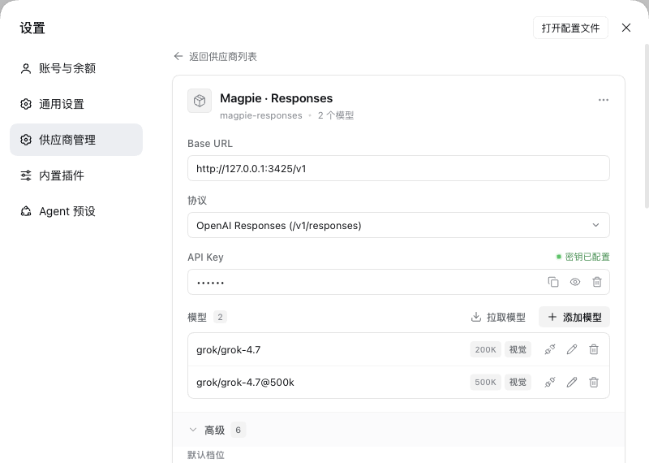
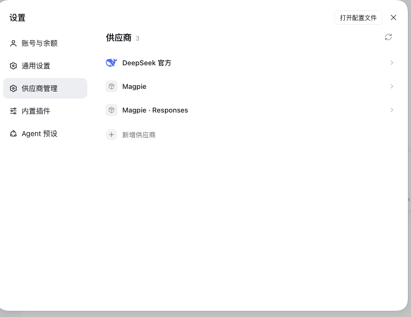
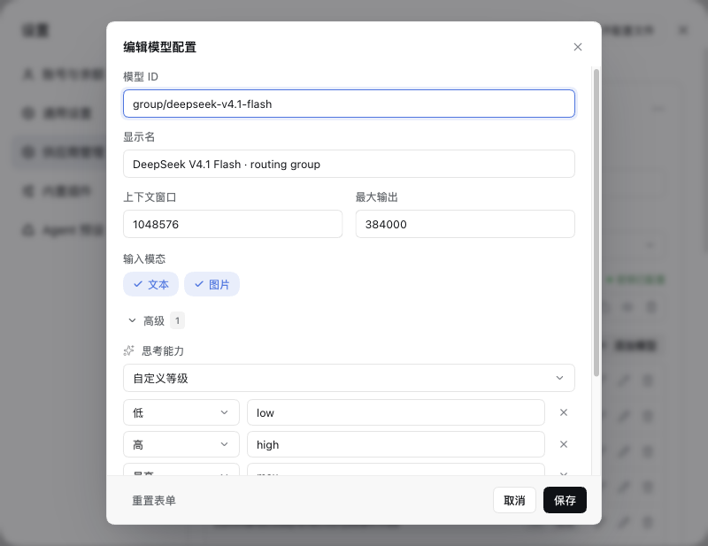

# dsh-provider-studio · 供应商管理

[English](README.md) · 简体中文

[DeepSeek Harness](https://github.com/deepseek-ai/deepseek-harness) 的供应商管理插件。它替换设置里的官方 **Models** 页，直接读写 `llm-pi-ai` 的供应商配置：浏览供应商、显示或更换 API 密钥、管理模型及其高级参数、测试连通性、从端点拉取模型，不用手改 `cordis.patch.yml`。

[](docs/zh/install.md#环境要求)
[](https://github.com/realchendahuang/dsh-provider-studio/releases)
[](https://github.com/realchendahuang/dsh-provider-studio/actions/workflows/check.yml)
[](LICENSE)
[](https://github.com/realchendahuang/dsh-provider-studio/stargazers)
[](https://github.com/realchendahuang/dsh-provider-studio/issues)



## 为什么用它

官方 Models 页只认 schema 投影后的字段：schema 没声明的会在保存时被丢掉，密钥只写不回显。这个插件直接解析 `llm-pi-ai` 的 patch 文档原文，所以：

- **密钥看得见**：默认掩码，可就地显示、复制、更换、清除；权威副本始终在 DSH 凭据服务里。
- **高级参数不丢**：模型自己的 `reasoningEfforts`、`compat`，供应商自己的请求头、传输与重试、图片预算，全都能改，保存不会悄悄丢。
- **一个供应商一页管完**：显示名、协议、Base URL、密钥、模型、连通性测试、批量拉取模型。
- **探针和真实请求一致**：测试与拉取沿用 DSH 实际下发的路径和自定义请求头。
- **218 个供应商模板**：来自 models.dev，其中 201 个带随包发布的品牌 logo，其余回退首字母。
- **配置能带走**：「复制配置」导出可直接贴进 `cordis.patch.yml` 的 YAML，只带凭据名，不带密钥。
- **随时能退回官方页**：bundle patch 里一行开关，改回去或卸载即恢复。

## 快速开始

需要 DSH 0.2.2-rc.1 及以上，`desktop` 或 `web` profile。

```bash
dsh plugin --profile desktop add github:realchendahuang/dsh-provider-studio#v1.3.1
```

桌面版也可以走图形界面：**插件 → 添加插件**，粘贴
`github:realchendahuang/dsh-provider-studio#v1.3.1`，安装后完整退出并重启 DSH。

重启后设置里出现「供应商管理」，官方 Models 页消失。

## 文档

| 文档 | 内容 |
|---|---|
| [安装](docs/zh/install.md) | 图形界面 / 命令行安装、profile、更新、卸载、版本兼容 |
| [使用](docs/zh/usage.md) | 每个界面、参数和快捷键，附截图 |
| [设计](docs/zh/design.md) | 为什么替换官方页、实现要点、已知限制 |
| [常见问题](docs/zh/faq.md) | 白屏、测试 404、密钥为空、peer 依赖警告 |
| [开发](docs/zh/development.md) | 构建、门禁、测试、发布流程、图标流水线 |

English: [Installation](docs/install.md) · [Usage](docs/usage.md) · [Design](docs/design.md) · [FAQ](docs/faq.md) · [Development](docs/development.md)

## 截图

| | |
|:---:|:---:|
| <br>供应商列表 | <br>模型弹窗，含模型自己的高级参数 |

其余截图见[使用文档](docs/zh/usage.md)。

## Star History

[](https://star-history.com/#realchendahuang/dsh-provider-studio&Date)

## 贡献

欢迎 issue 和 PR。提 PR 前跑 `npm run check` 与 `npm test`，细节见[开发文档](docs/zh/development.md)。

## License

[MIT](LICENSE) © 2026 dsh-provider-studio contributors；第三方素材与商标见 [THIRD_PARTY_NOTICES.md](THIRD_PARTY_NOTICES.md)。
