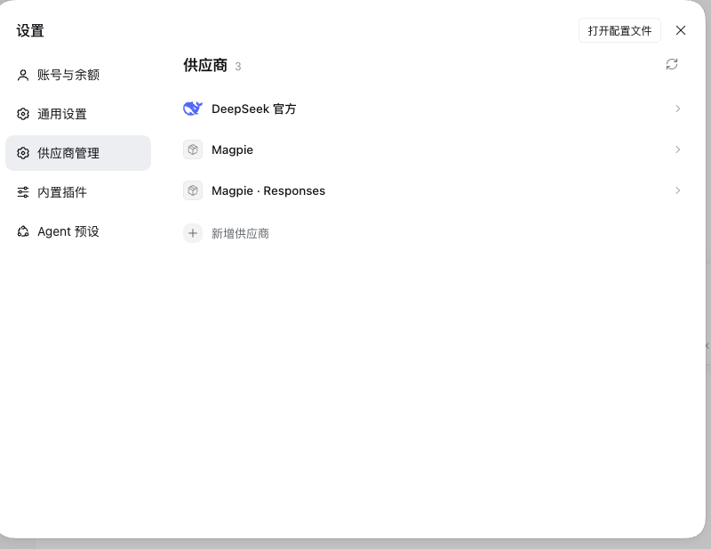
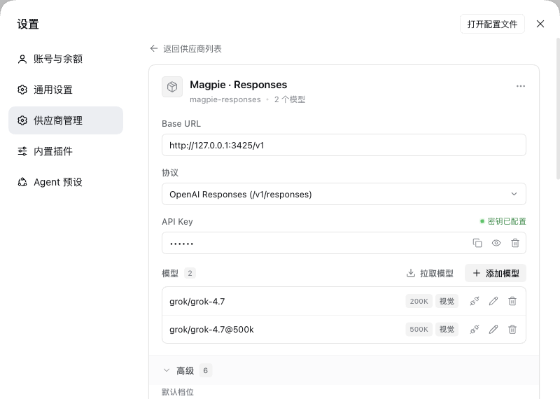
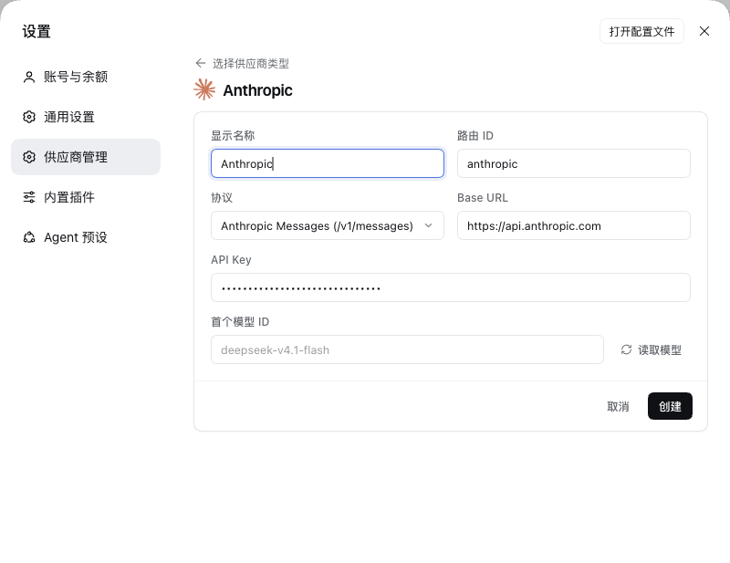
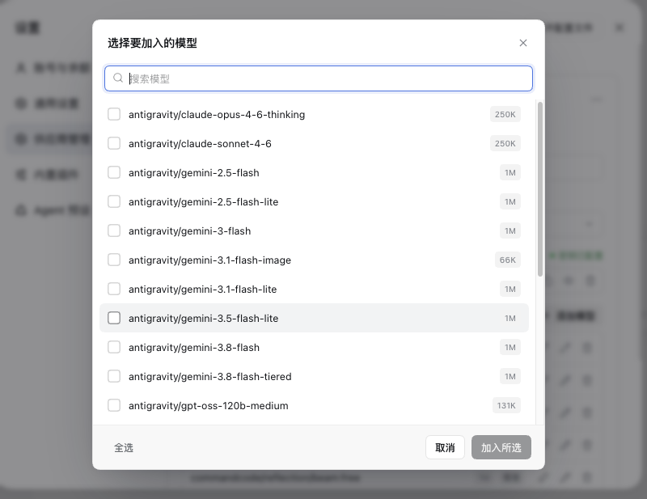
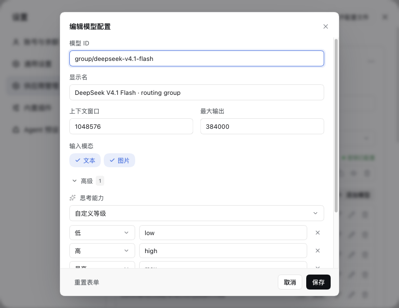
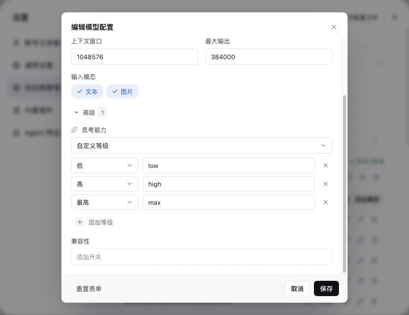
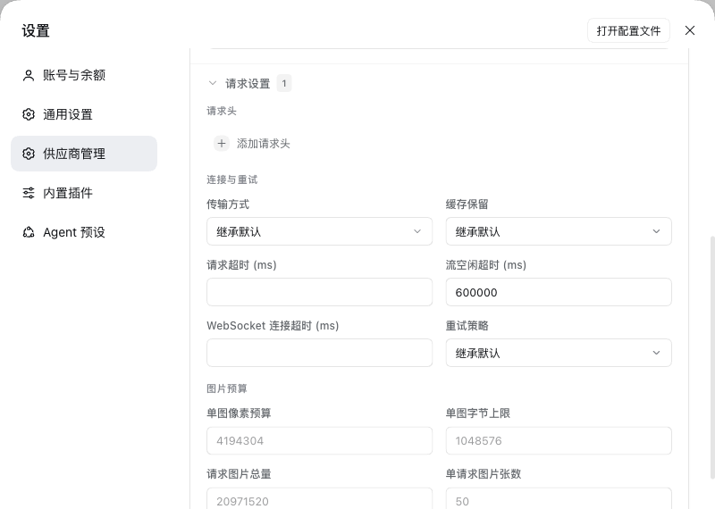
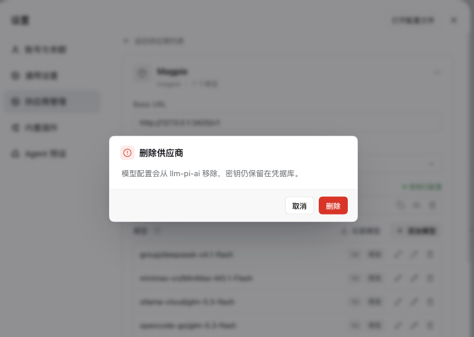
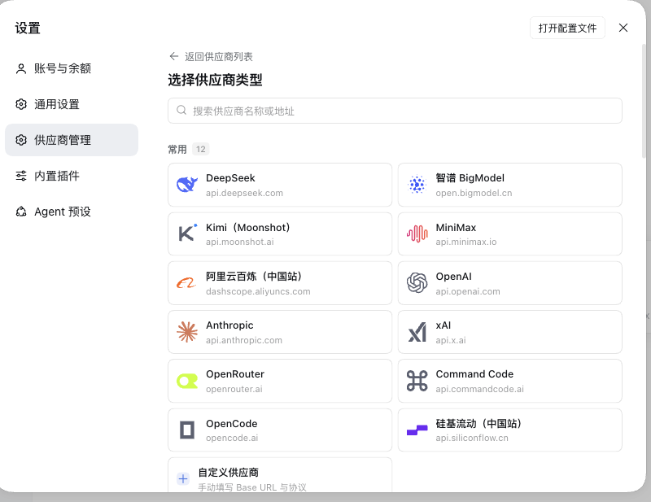
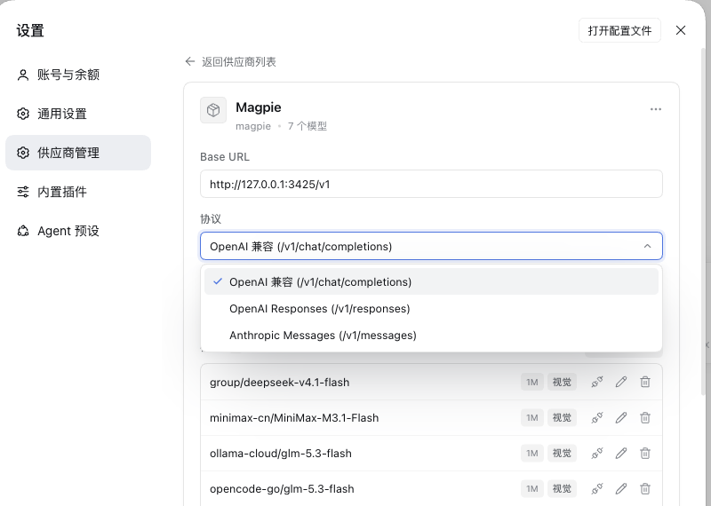

# Usage

[English](usage.md) · [简体中文](zh/usage.md)

## Open

Settings → **Providers** (listed as **Provider Studio** on the Plugins page). The page lists every `llm-pi-ai` provider in the current profile, plus a built-in **DeepSeek** entry (from `llm-deepseek`) that can be edited but not deleted.

| | |
|:---:|:---:|
| <br>The provider list: names only, click one to open it | <br>Detail: URL, protocol, key and models on one page |

## Add a provider

1. Click **+ Add provider** at the bottom of the list.
2. Pick a template (browse by group or search by name/domain), or **Custom provider** to start from scratch.
3. Fill in the form:
   - **Display name** — what the list shows; falls back to the route ID when empty.
   - **Route ID** — the unique key in the configuration: letters, digits, `.`, `_`, `-`. Do not change it after creation.
   - **Protocol** — OpenAI-compatible (`/chat/completions`), OpenAI Responses (`/responses`), or Anthropic Messages (`/v1/messages`).
   - **Base URL** — for OpenAI-style protocols include `/v1` (`https://api.openai.com/v1`); for Anthropic use the **root** (`https://api.anthropic.com`) because the client appends `/v1/messages`. A trailing `/v1` on Anthropic is flagged under the field.
   - **API key** — may stay empty and be filled in later; needed for **Discover models** in this step.
   - **First model ID** — type it, or click **Discover models** and pick from the endpoint's list (manual entry still works when discovery fails).
4. Click **Create**; the new provider's detail page opens.

| | |
|:---:|:---:|
| <br>Pick a template, add a key, discover models |

## API key

- Click the API key field to edit: an existing key shows as a mask, becomes real on focus, and saves on Enter.
- Three actions sit on the right: copy, show/hide, clear (when a value exists). Clear asks for confirmation.
- The key is written to DSH's credentials service only — not into the `llm-pi-ai` config, not to any file owned by this plugin.
- The credential name (environment variable) is derived from the route on creation (for example `deepseek` → `DEEPSEEK_API_KEY`) and is not rewritten when editing an existing provider.

## Discover models

Click **Discover models** above the model table. The plugin queries the endpoint with the current Base URL, key and the custom headers from **Request settings** (OpenAI-style `GET {baseURL}/models`, Anthropic `GET {root}/v1/models`). The dialog supports search, select-all and individual selection; **Add selected** merges them into the model table as a **draft** — nothing is written until **Save**.

| | |
|:---:|:---:|
| <br>Search, select all, add in bulk |

## Test connectivity

The **Test** button on each model row sends a real minimal request:

- to the protocol's real path (`{baseURL}/chat/completions`, `{baseURL}/responses`, `{baseURL}/v1/messages`), with the custom headers from **Request settings** — the same request DSH makes;
- chat-style protocols send `max_tokens: 1` (Responses sends `max_output_tokens: 16`), with a 20 s timeout;
- success shows `✓ latency`; failure shows a red badge whose tooltip holds the HTTP error;
- the result disappears after about 6 seconds.

## Edit or delete a model

Click the model ID or the pencil icon to open the dialog: model ID, display name, context window, max output, input modalities (text / image), with a reset action. Deleting a model only changes the draft; it applies on **Save**.

| | |
|:---:|:---:|
| <br>Basic fields plus the model's own advanced parameters |

## Model advanced parameters

Below **Input modalities** the dialog has the **model's own** advanced section, collapsed by default (expanded automatically when the model already declares reasoning tiers or compat switches). The number next to the title counts current overrides.

**Reasoning tiers** (`reasoningEfforts`) — one of:

- **Inherit built-in catalog** (default): nothing is declared, so pi-ai's model catalog decides.
- **No reasoning**: writes `reasoningEfforts: false`, marking a non-reasoning model.
- **Custom tiers**: declare each tier and the value actually sent, for example `low / low`, `max / max`; the value of `off` may stay empty. **Add tier** appends the next tier in ascending order (with low/medium/high present it adds `max`). At least one tier other than `off` must remain, otherwise save is refused.

**Compat switches** (`compat`) — the available fields depend on the protocol: OpenAI-compatible has 19 (`thinkingFormat`, `maxTokensField`, `chat_template_kwargs`, …), Responses has 4, Anthropic has 7. Each is a switch or an enum; unset fields are left to pi-ai.

| | |
|:---:|:---:|
| <br>Compat fields for the current protocol |

## Provider request settings

Below the model table sits the **provider's own** **Request settings** section, deliberately separate from model parameters. Collapsed by default; the number on the title counts current overrides.

- **Headers** — custom HTTP headers, often used by gateways for auth or routing.
- **Connection and retries** — transport (auto / sse / websocket…), cache retention, request timeout, stream idle timeout, WebSocket connect timeout, retry policy and count.
- **Image budgets** — per-image pixel budget, per-image byte limit, total request image bytes, images per request, offload granularity.

The built-in **DeepSeek** row uses `llm-deepseek`'s own vocabulary and has its own advanced section: thinking mode, reasoning tier, output cap, stream idle timeout, retry policy.

| | |
|:---:|:---:|
| <br>Headers, transport and retries, image budgets |

## Rename or delete a provider

- Click the title to rename in place; Enter confirms, Esc cancels.
- **…** next to the title → **Rename** / **Delete provider**; deletion asks for confirmation first.

| | |
|:---:|:---:|
| <br>Confirmation before deleting a provider (clearing a key or discarding edits works the same) |

## Export config

**…** → **Copy config** exports one provider as YAML ready to paste:

```yaml
- id: llm-pi-ai
  name: "@deepseek-ai/dsh-llm-pi-ai"
  config:
    providers:
      my-gateway:
        displayName: My Gateway
        api: openai-completions
        baseURL: https://api.example.com/v1
        apiKeyEnv: MY_GATEWAY_API_KEY
        models: ...
```

- It comes from the profile's patch document rather than the schema projection, so hand-written `reasoningEfforts`, `compat` and headers survive.
- **No key material**: only the `apiKeyEnv` credential name is exported; another machine needs the key entered again.
- The built-in DeepSeek row exports the same way, shaped as `- id: llm-deepseek`.
- Paste it into the top-level list of `cordis.patch.yml` (typical for a new profile); when the entry already exists, merge the block under `providers` by hand.

## Save rules

- **Save** is enabled only with changes; a hint on the left says there are unsaved edits. `Cmd/Ctrl+S` is equivalent.
- **Reload** discards the draft and re-reads the configuration from disk.
- Leaving the page with unsaved edits asks whether to discard them.
- Success and failure both show a toast in the bottom-right corner; a write that did not reach disk is reported separately rather than reported as success.

| | |
|:---:|:---:|
| <br>Save feedback as a toast, without interrupting the page |

## Parameter layering

Each setting belongs to exactly one owner:

| Location | Owns | Fields |
|---|---|---|
| Model dialog → **Advanced** | The model itself | `reasoningEfforts`, `compat` |
| Provider page → **Request settings** | The provider's connection and requests | `headers`, `transport`, `cacheRetention`, `timeoutMs`, `streamIdleTimeoutMs`, `websocketConnectTimeoutMs`, `retryPolicy`, `requestImagePixelBudget`, `requestImageMaxBytes`, `maxRequestImageBytes`, `maxRequestImages`, `imageOffloadCountQuantum` |

- Anything unset stays empty (= pi-ai default); set fields are counted on the collapsed title.
- Model-level `compat` filters its options by the current protocol; switching protocols never writes back fields of the old one, and the Host validates against pi-ai's rules on save.
- Numeric fields follow pi-ai's constraints (positive integers, enum values, required `retryPolicy.mode`); invalid values fail on save.
- Route-level fallbacks (`defaultContextWindow`, `defaultMaxTokens`, `defaultInput`, `reasoning`, `thinkingBudgets`) and `modelOverrides` are not in the UI: they only apply when a model declares nothing, so normal setups use the model's own fields. Edit `cordis.patch.yml` by hand if you need them.

## Templates and logos

- The template picker uses [models.dev](https://github.com/sst/models-dev)'s full provider catalog (name, API root, environment variable, protocol mapping): **218 entries**.
- 45 curated entries carry a Chinese name and groups (Popular / Domestic / Overseas / Gateways); the other 173 live under **More providers**. Each group shows 12 by default and expands; the search box matches every entry.
- Templates prefill display name, route ID, protocol and Base URL only — models are not prefilled; use **Discover models** to fetch what the account can actually call.
- Anthropic templates give the **root** URL (`https://api.anthropic.com`); the client appends `/v1/messages`, so do not add `/v1`.
- Brand logos: 184 are shipped with the package (72 SVG + 112 48×48 WebP, sources in [Design](design.md#credits)) and loaded on demand from `/plugins/dsh-provider-studio/assets/` instead of being inlined into `client.js`. 201 of the 218 templates have an icon, 1 matches by keyword rule, and the remaining 16 show initials.
- Vendors that need a dedicated SDK (Google, Bedrock, Azure, …) are not included: DSH's `llm-pi-ai` supports the three protocols above only.
- The Popular group also contains **Custom provider** for any OpenAI-compatible endpoint.

| | |
|:---:|:---:|
| <br>218 templates, 201 with a brand logo | <br>Protocol select: drawn in-app, not a system menu |
