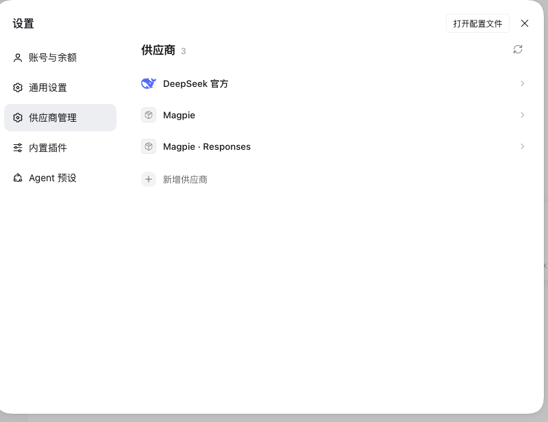
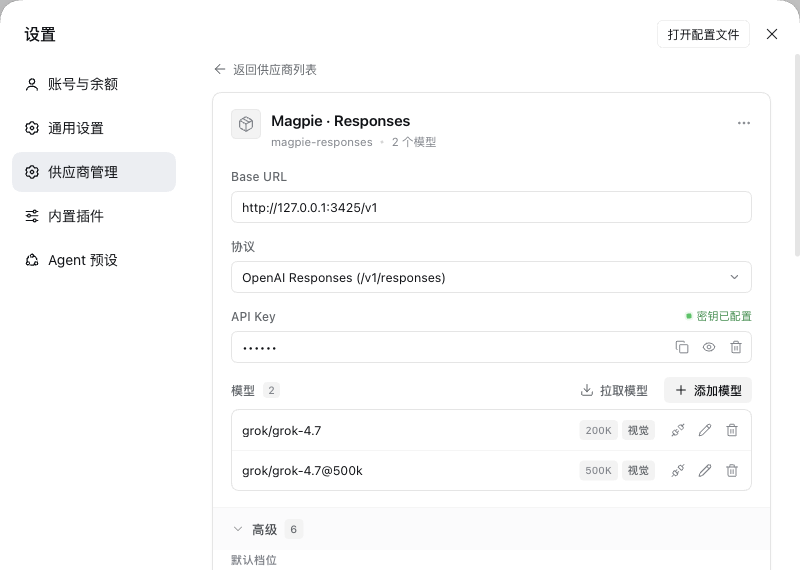
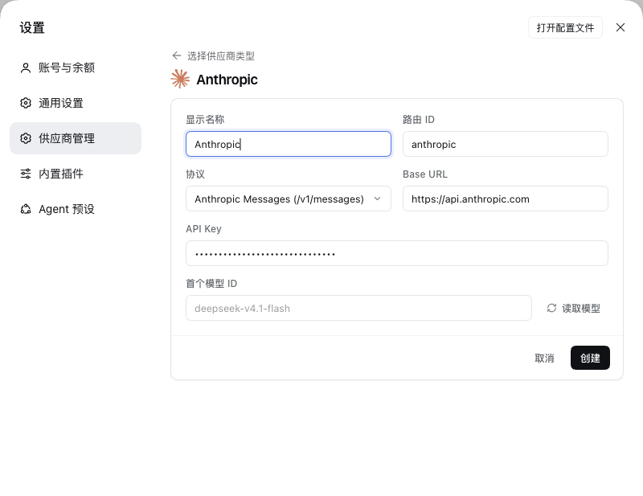
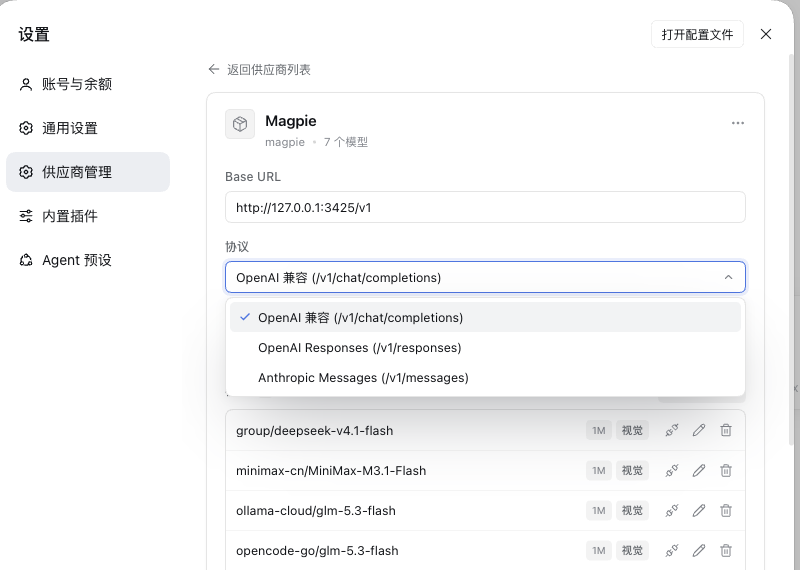
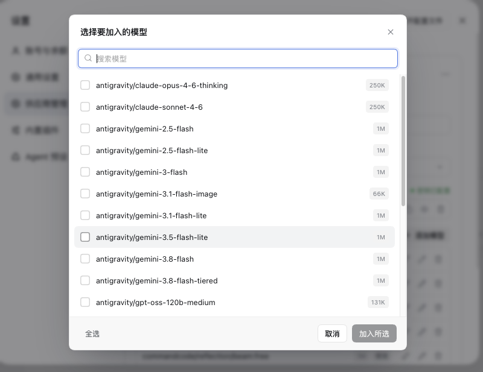
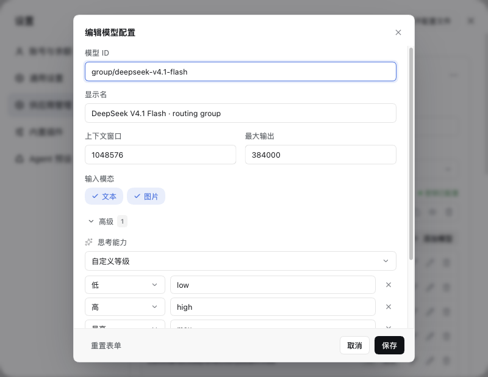
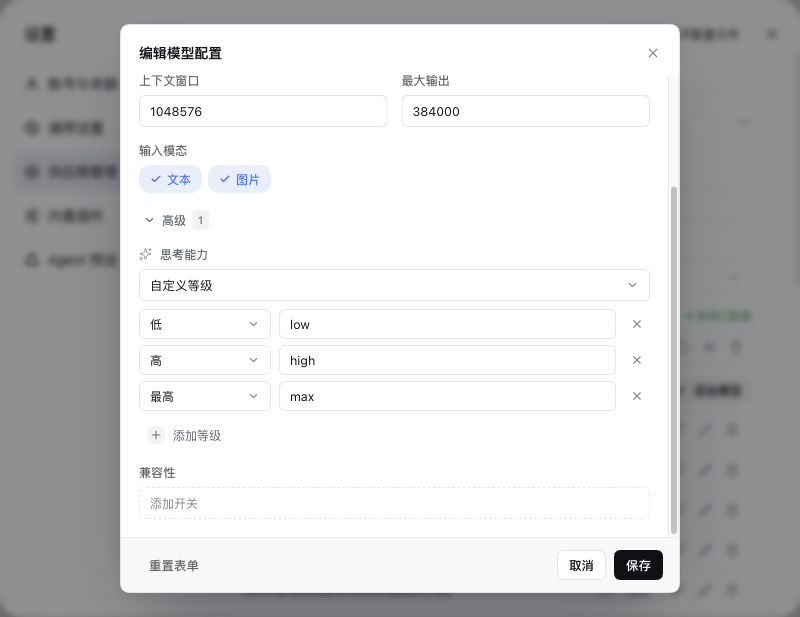
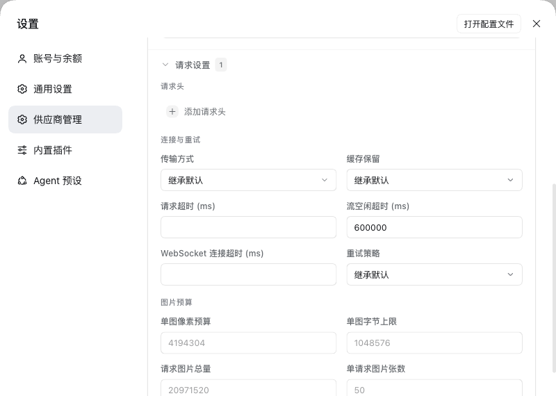
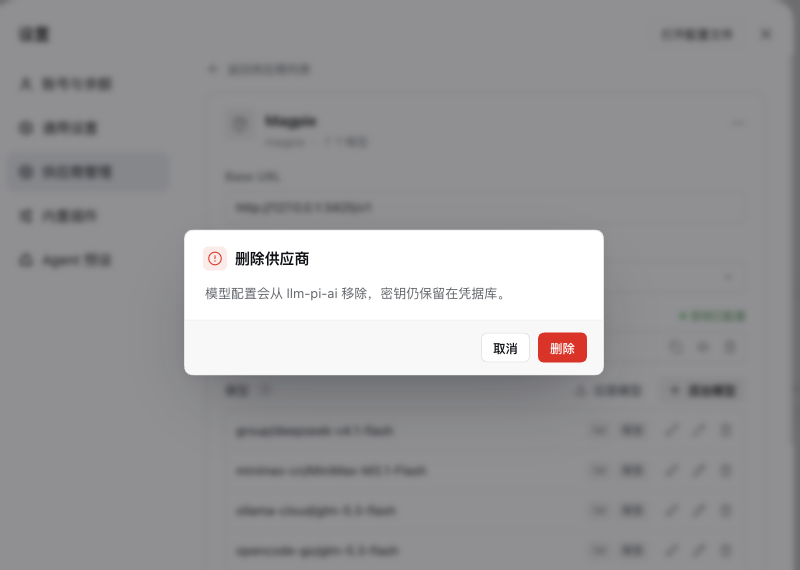
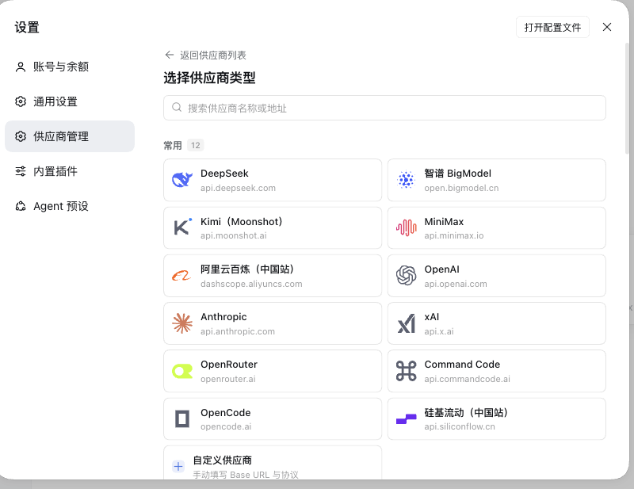

# 使用

[English](../usage.md) | 简体中文

## 打开

设置 →「供应商管理」（英文界面为 Providers）。页面列出当前 profile 的所有 `llm-pi-ai` 供应商，外加内置的 **DeepSeek 官方**（来自 `llm-deepseek`，可编辑、不可删除）。设置服务只读时，页面会提示并禁用保存。

|  |  |
|:---:|:---:|
|  |  |

## 新增供应商

1. 列表底部点「+ 新增供应商」。
2. 选一个模板（按分组浏览或搜索名称 / 域名），或选「自定义供应商」从空白开始。
3. 填写表单：
   - **显示名称**：列表里显示的名字，留空则用路由 ID。
   - **路由 ID**：配置里的唯一键，只能包含字母、数字、`.`、`_`、`-`，创建后不建议改。
   - **协议**：OpenAI 兼容（`/chat/completions`）、OpenAI Responses（`/responses`）、Anthropic Messages（`/v1/messages`）。
   - **Base URL**：OpenAI 系填到 `/v1`（如 `https://api.openai.com/v1`）；Anthropic 填根地址（如 `https://api.anthropic.com`），`/v1/messages` 由客户端补，填成 `…/v1` 会在输入框下方提示。
   - **API Key**：可以留空，稍后在详情页补；填了才能用下一步的「读取模型」。
   - **首个模型 ID**：手填 model id，或点右侧「读取模型」向端点要一份列表，从下拉里选（读不到时仍可手填）。
4. 点「创建」，成功后自动进入该供应商的详情页。

|  |  |
|:---:|:---:|
|  |  |

## 填写 / 更换密钥

- 点 API Key 输入框即可编辑：已配置的密钥先显示为掩码，聚焦后变成真实值，改完回车保存。
- 输入框右侧三个动作：复制、显示 / 隐藏、清除（有值时）；清除会先弹确认。
- 密钥只写进 DSH 凭据服务，不写进 `llm-pi-ai` 配置，也不落本插件的文件。
- 凭据名（环境变量名）在创建时按 route 派生（如 `deepseek` → `DEEPSEEK_API_KEY`）；编辑已有供应商不会改写它。
- 密钥来自环境变量时输入框显示为空，插件不会伪造明文；直接粘贴新密钥即可覆盖（见[常见问题](faq.md)）。

## 拉取模型

点模型区右上角的「拉取模型」，插件用当前 Base URL、密钥和「请求设置」里的自定义请求头去取模型列表（OpenAI 系 `GET {baseURL}/models`，Anthropic 为 `GET {root}/v1/models`）。弹窗里可搜索、全选 / 清空或逐个勾选，点「加入所选」并入模型表——这时还只是草稿，点「保存」才写盘。

|  |
|:---:|
|  |

## 测试连通性

每个模型行右侧的「测试」按钮会发一个**真实**最小请求：

- 按协议发到真实路径（`{baseURL}/chat/completions`、`{baseURL}/responses`、`{baseURL}/v1/messages`），并带上「请求设置」里的自定义请求头，和 DSH 实际下发的一致；
- 聊天类协议发 `max_tokens: 1`，Responses 类发 `max_output_tokens: 16`，Anthropic 类同理，20 秒超时；
- 成功显示 `✓ 延迟`，失败显示红色失败徽章，鼠标悬停看具体 HTTP 错误；
- 结果约 6 秒后自动消失。

插件只跟随同一源内的重定向；跨源重定向返回 `PROBE_REDIRECT`，避免把 API Key（尤其 `x-api-key`）带到别的主机。测试结果不会写入配置。

## 编辑 / 删除模型

- 点模型 ID 或铅笔图标打开弹窗：模型 ID、显示名、上下文窗口、最大输出、输入模态（文本 / 图片），可以重置表单。
- 模型表一行一个模型：模型 ID、上下文窗口徽章、视觉能力徽章，以及测试 / 编辑 / 删除三个动作。
- 删除模型只改草稿，保存后才生效。
- pi-ai 的模型字段都在界面上：`name`、`contextWindow`、`maxTokens`、`input`、`reasoningEfforts`、`compat`。
- 页面内部的 `input` 与 DSH 的 `inputModalities` 在边界互相转换；内置 DeepSeek 的模型条目使用它自己的词汇（`inputModalities`），不套用 pi-ai 字段。

|  |
|:---:|
|  |

## 模型的高级参数（思考等级 + 兼容开关）

模型弹窗里，「输入模态」下面是**模型的**「高级」，默认收起（模型已经声明过思考等级或兼容开关时自动展开），标题旁的数字表示当前覆盖了几项。这里只有模型自己的东西：

- **思考能力**（`reasoningEfforts`）三选一：
  - **继承内置目录**（默认）：不在配置里声明，交给 pi-ai 的模型目录决定；
  - **不支持思考**：写入 `reasoningEfforts: false`，明确声明这是非推理模型；
  - **自定义等级**：一条一条声明「等级 → 实际发送值」，例如 `低 / low`、`最高 / max`；`关` 的发送值可以留空。「添加等级」会按升级顺序补下一个档位（已有 low/medium/high 时补 `max`）。至少要保留一个 `off` 以外的等级，否则保存会被拦下并提示。
- **兼容开关**（`compat`）：可选字段随协议变化——OpenAI 兼容 19 项（`thinkingFormat`、`maxTokensField`、`chat_template_kwargs` 等）、Responses 4 项、Anthropic 7 项；每项是开关或枚举下拉，不设置就交给 pi-ai 自动判断。

|  |
|:---:|
|  |

## 供应商的请求设置（请求头 / 连接与重试 / 图片预算）

供应商详情页模型表下面是**供应商自己的**「请求设置」，和模型参数完全分开；默认收起，标题上的数字表示当前覆盖了多少项：

- **请求头**：自定义 HTTP 头，网关做鉴权 / 路由时常用。
- **连接与重试**：`transport`（auto / sse / websocket 等）、`cacheRetention`、`timeoutMs`、`streamIdleTimeoutMs`、`websocketConnectTimeoutMs`、`retryPolicy`（策略与次数，`mode` 必填）。
- **图片预算**：`requestImagePixelBudget`、`requestImageMaxBytes`、`maxRequestImageBytes`、`maxRequestImages`、`imageOffloadCountQuantum`。

未设置的项留空，即沿用 pi-ai 默认；所有数值按 pi-ai 的约束校验（正整数、枚举取值），不合法的值在保存时直接报错。

内置 **DeepSeek 官方**行是 llm-deepseek 自己的词汇，也有一个只属于它的高级区：思考模式、推理等级、输出上限、流空闲超时、重试策略。

|  |
|:---:|
|  |

## 重命名 / 删除供应商

- 点标题就地改名，回车确认，Esc 取消。
- 标题右侧 `…` →「重命名」/「删除供应商」；删除前会弹确认。

|  |
|:---:|
|  |

## 导出配置

供应商详情页标题右侧 `…` →「复制配置」，把这一条导出成可直接使用的 YAML：

```yaml
- id: llm-pi-ai
  name: "@deepseek-ai/dsh-llm-pi-ai"
  config:
    providers:
      my-gateway:
        displayName: My Gateway
        api: openai-completions
        baseURL: https://api.example.com/v1
        apiKeyEnv: MY_GATEWAY_API_KEY
        models: ...
```

- 内容取自 profile 的 patch 文档而不是 schema 投影，手写的 `reasoningEfforts`、`compat`、请求头都会原样带出来。
- **不含密钥**：配置里只有 `apiKeyEnv` 这个凭据名，换台机器还得重新填一次密钥。
- 内置 DeepSeek 行同样可导出，形状是 `- id: llm-deepseek`。
- 贴进 `cordis.patch.yml` 顶层列表即可（适合新 profile）；本机已有同名条目时，手动合并 `providers` 下那一块。

## 保存规则

- 底部「保存」在有改动时才可点，左侧会提示「有未保存的更改」；`Cmd/Ctrl+S` 等效。
- 「重新加载」丢弃草稿、重新读一次磁盘配置。
- 有未保存改动时返回列表，会先确认是否放弃。
- 保存成功 / 失败都以右下角 Toast 提示；写入未真正落盘会单独报错，不会假装成功。

|  |
|:---:|
|  |

## 参数的分层

界面按「谁的东西放谁那儿」切开，两边互不串：

| 位置 | 只管 | 字段 |
|---|---|---|
| 模型弹窗 →「高级」 | 模型自己 | `reasoningEfforts`、`compat` |
| 供应商详情 →「请求设置」 | 供应商自己的连接与请求 | `headers`、`transport`、`cacheRetention`、`timeoutMs`、`streamIdleTimeoutMs`、`websocketConnectTimeoutMs`、`retryPolicy`、`requestImagePixelBudget`、`requestImageMaxBytes`、`maxRequestImageBytes`、`maxRequestImages`、`imageOffloadCountQuantum` |

- 未设置的项一律留空（= 沿用 pi-ai 默认），设置过的项在折叠时计入标题旁的数字。
- 模型级 `compat` 按当前协议过滤可选项，换了协议不会把旧协议的开关偷偷写回去；保存时 Host 再按 pi-ai 的规则校验一遍。
- 所有数值字段按 pi-ai 的约束校验（正整数、枚举取值、`retryPolicy.mode` 必填），不合法的值在保存时直接报错。
- 路由级的模型缺省值（`defaultContextWindow`、`defaultMaxTokens`、`defaultInput`、`reasoning`、`thinkingBudgets`）和 `modelOverrides` 没有进界面：它们只在「模型自己什么都没声明」时兜底，确实需要时手写 `cordis.patch.yml`。

## 从端点拉取模型

- 用当前 Base URL、密钥和自定义请求头取模型列表：OpenAI 系 `GET {baseURL}/models`，Anthropic 为 `GET {root}/v1/models`（`root` 是去掉末尾 `/v1` 的 Base URL），与 `dsh-llm-pi-ai` 自身的拉取逻辑一致。
- 同时兼容 OpenAI 风格（`data[]`）、Anthropic 风格（`data[]` / `models[]`）以及裸数组三种返回。
- 弹窗列出端点返回的模型，可搜索、全选 / 清空，勾选后批量并入模型表。
- 「新增供应商」里也能用同一套逻辑（填好密钥后点「读取模型」），只是结果落到「首个模型 ID」而不是模型表。

## 模板与 logo

- 模板来自 [models.dev](https://github.com/sst/models-dev) 的全量供应商目录（名称、API root、环境变量名、协议映射），共 **218 个**。
- 其中 45 个精选条目带中文名并分组（常用 / 国内厂商 / 海外厂商 / 网关），其余 173 个在「更多供应商」组；每组默认显示 12 个、可展开，顶部搜索框可检索全部条目。
- 模板只预填显示名 / 路由 ID / 协议 / Base URL；模型不预填——点「读取模型」按账户实际可用的型号现取。
- Anthropic 协议的模板给的是**根地址**（如 `https://api.anthropic.com`），`/v1/messages` 由客户端补，所以不要在 Base URL 末尾再加 `/v1`。
- 品牌 logo 随包发布 184 个（72 个 SVG + 112 个 48×48 WebP），由 `/plugins/dsh-provider-studio/assets/` 按需加载，不进 `client.js`；218 个模板中 201 个带品牌 logo，其余显示首字母占位。
- 需要专用 SDK 的厂商（Google、Bedrock、Azure 等）不收录，因为 `llm-pi-ai` 只支持上面三种协议。
- 「常用」分组里还带一个「自定义供应商」入口，用于任意 OpenAI 兼容端点。
- 数据与图标来源见[设计](design.md)的「数据来源与致谢」。

|  |
|:---:|
|  |
